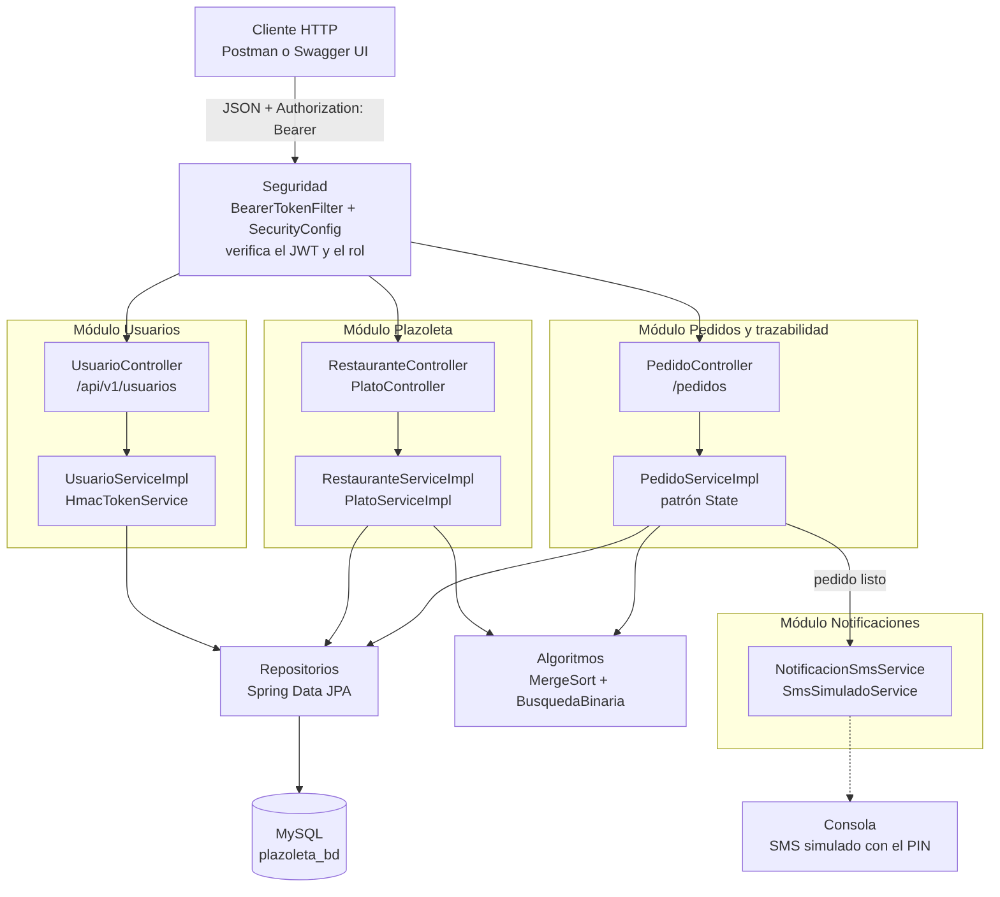

# Arquitectura

El repositorio contiene una sola aplicación Spring Boot que reúne cuentas, autenticación, restaurantes, platos y pedidos. Se ejecuta en el puerto `8080` y las validaciones sobre usuarios se resuelven con servicios locales, sin llamadas HTTP internas.

Los cuatro módulos del enunciado (Usuarios, Plazoleta, Trazabilidad y Notificaciones) están separados por paquetes y servicios dentro de la misma aplicación. Notificaciones se comunica con el resto solo a través de la interfaz `NotificacionSmsService`.

Fuente editable: [`diagramas/arquitectura.mmd`](diagramas/arquitectura.mmd). El modelo de datos está en [`modelo-relacional.md`](modelo-relacional.md) y las clases en [`diagrama-clases.md`](diagrama-clases.md).

## Capas

- `controller`: API REST y conversión de contratos HTTP.
- `dto/request` y `dto/response`: contratos HTTP de entrada y salida.
- `service`: contratos de negocio y validaciones locales de propietario y pertenencia.
- `service/impl`: implementaciones de los contratos de servicio.
- `entity`: entidades JPA `Usuario`, `EmpleadoRestaurante`, `Restaurante`, `Plato`, `Pedido`, `DetallePedido` y `HistorialPedido`, y los enumerados `Rol` y `EstadoPedido`.
- `entity/estado`: patrón State con las transiciones permitidas en cada estado del pedido.
- `algoritmo`: merge sort y búsqueda binaria.
- `repository`: persistencia mediante Spring Data JPA.
- `security`: emisión y verificación de JWT, principal autenticado y creación opcional del primer administrador.
- `config`: autorización de rutas, codificador de contraseñas y clave de firma.
- `exception`: excepciones y traducción de errores a respuestas HTTP.

## Ciclo del pedido

`Pedido` delega cada transición en el objeto `PedidoState` de su estado actual. `PedidoServiceImpl` comprueba permisos, bloquea la fila del pedido durante la transacción y guarda un registro en `pedido_historial` por cada cambio. El PIN se guarda como hash BCrypt y se borra al entregar. `NotificacionSmsService` aísla el envío de SMS; la implementación actual, `SmsSimuladoService`, lo escribe en la consola.

## Persistencia

MySQL (`plazoleta_bd`) es la base de ejecución local; `SPRING_DATASOURCE_URL` y las credenciales pueden cambiarse por entorno. H2 se utiliza solo en pruebas. `Restaurante` guarda `idPropietario` como referencia a un `Usuario`; `Plato` tiene una relación muchos-a-uno con `Restaurante`; `EmpleadoRestaurante` vincula a cada empleado con su restaurante. Las migraciones de producción deben sustituir `ddl-auto=update`.

## Seguridad

`POST /api/v1/usuarios/login` comprueba las credenciales y `HmacTokenService` emite un JWT HS256 con `sub`, `rol`, `exp` y, para empleados, `idRestaurante`. En cada solicitud, `BearerTokenFilter` verifica el token y crea el principal; `SecurityConfig` aplica las reglas por rol y los servicios comprueban la propiedad de cada recurso.

La API está documentada con OpenAPI (springdoc): `/swagger-ui.html` muestra la documentación interactiva y `/v3/api-docs` la especificación en JSON. Ambas rutas son públicas, pero cada operación conserva sus permisos.

`JwtKeyConfig` genera una clave de firma aleatoria en cada arranque, de modo que los tokens dejan de servir al reiniciar. Para producción o para varias instancias habría que cargar una clave fija desde un gestor de secretos.
