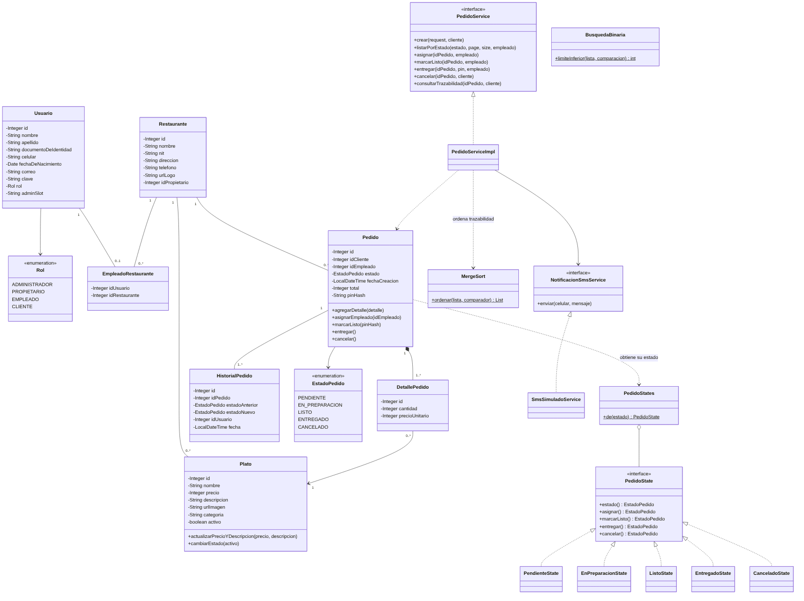

# Diagrama de clases

Incluye las entidades del dominio, el patrón State del pedido, el servicio de pedidos, el envío de SMS y los dos algoritmos. Los DTO, controladores y repositorios se omiten para que el diagrama sea legible; su organización está en [`arquitectura.md`](arquitectura.md).

Fuente editable: [`diagramas/clases.mmd`](diagramas/clases.mmd) (formato Mermaid).

## Cómo leerlo

- **Dominio:** `Usuario`, `Restaurante`, `Plato`, `Pedido`, `DetallePedido`, `HistorialPedido` y `EmpleadoRestaurante` son las entidades JPA, una por tabla.
- **Patrón State:** `Pedido` no decide por sí mismo qué cambios de estado son válidos. Le pide a `PedidoStates` el objeto `PedidoState` de su estado actual, y ese objeto acepta la transición o lanza un error. Las cinco clases `...State` implementan la interfaz.
- **Servicios:** `PedidoServiceImpl` implementa `PedidoService`. Comprueba permisos, cambia el estado, guarda la trazabilidad y usa `NotificacionSmsService` para el PIN. `SmsSimuladoService` es la implementación actual, que escribe el SMS en la consola.
- **Algoritmos:** `MergeSort` ordena la trazabilidad y el menú; `BusquedaBinaria` busca platos por nombre.

## Símbolos

| Símbolo | Significado |
| --- | --- |
| `<|..` | Implementa una interfaz |
| `*--` | Composición: el detalle no existe sin su pedido |
| `o--` | Agregación: `PedidoStates` reúne las instancias de cada estado |
| `-->` | Asociación o uso directo |
| `..>` | Dependencia: usa la clase sin guardarla |
| `$` (subrayado) | Método estático |
