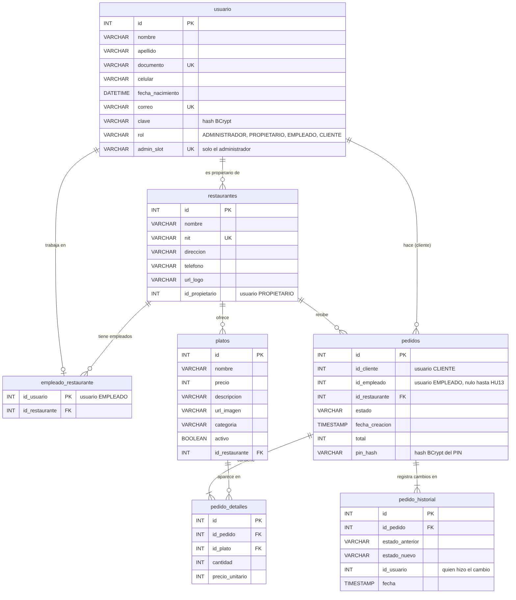

# Modelo relacional

Base de datos MySQL `plazoleta_bd`. El script que crea estas tablas es [`database/plazoleta_schema.sql`](../database/plazoleta_schema.sql).

La fuente editable del diagrama está en [`diagramas/modelo-relacional.mmd`](diagramas/modelo-relacional.mmd) (formato Mermaid). GitHub la dibuja automáticamente, y también se puede abrir en [mermaid.live](https://mermaid.live).

## Tablas

| Tabla | Qué guarda | Historias |
| --- | --- | --- |
| `usuario` | Cuentas de los cuatro roles, con la clave cifrada con BCrypt | HU1, HU5, HU6, HU8 |
| `restaurantes` | Restaurantes y el ID de su propietario | HU2, HU9 |
| `empleado_restaurante` | A qué restaurante pertenece cada empleado | HU6, HU12 |
| `platos` | Menú de cada restaurante | HU3, HU4, HU7, HU10 |
| `pedidos` | Cabecera del pedido: cliente, empleado asignado, estado, total y PIN cifrado | HU11 a HU16 |
| `pedido_detalles` | Platos de cada pedido, con el precio del momento de la compra | HU11 |
| `pedido_historial` | Un registro por cada cambio de estado de un pedido | HU17 |

## Reglas que garantiza la base

- **Únicos:** `usuario.correo`, `usuario.documento` y `restaurantes.nit` no se repiten.
- **Un solo administrador:** `usuario.admin_slot` es único y solo el administrador lo llena.
- **Un restaurante por empleado:** `empleado_restaurante.id_usuario` es la clave primaria.
- **Un plato por línea de pedido:** `pedido_detalles` no repite el par (`id_pedido`, `id_plato`).
- **Valores positivos:** precios, cantidades y totales tienen restricciones `CHECK`.

## Relaciones

- Un **usuario propietario** puede tener varios **restaurantes**; cada restaurante tiene un solo propietario.
- Un **restaurante** tiene varios **platos**, **empleados** y **pedidos**.
- Un **cliente** puede tener muchos **pedidos**, pero solo uno en curso a la vez (regla de HU11 aplicada por el servicio).
- Un **pedido** tiene uno o más **detalles** y uno o más registros de **historial**.

`restaurantes.id_propietario`, `pedidos.id_cliente` y `pedidos.id_empleado` apuntan a `usuario.id`, pero no tienen clave foránea en la base: el rol de cada usuario lo valida la aplicación al crear el registro. El estado del pedido se guarda como texto (`PENDIENTE`, `EN_PREPARACION`, `LISTO`, `ENTREGADO`, `CANCELADO`).
